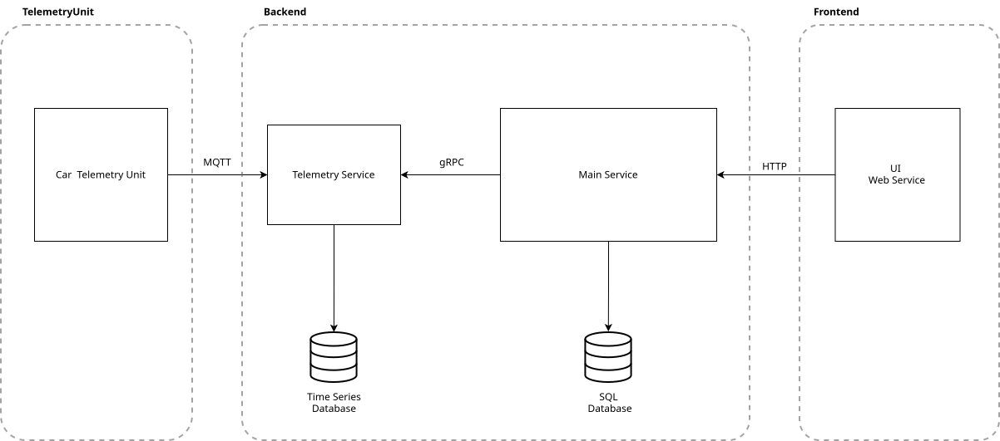

# FleetControl
Frontend and backend for a vehicle telemetry and fleet control system university project.
A system to manage and monitor vehicle fleets and assigned drivers.

It allows to register and manage vehicles, drivers and telemetry units.
Telemetry units are connected to vehicles and collect telemetry data to enable monitoring of all vehicles
of a vehicle fleet and the associated drivers.
Telemetry units collect data like GPS position, speed and acceleration.

Component diagram as planned for implementation :



## Architecture

FleetControl is built as a distributed microservice application so that individual components can be
scaled independently. Each backend service ships as its own Docker container with all dependencies
included, and Docker Compose files are provided for every service to make local and production
deployment straightforward.

## Getting Started

The following steps set up the application, in the given implementation structure, in a fresh
environment.

### Prerequisites

* Docker and Docker Compose

### 1. Clone the repository and move to the project root

```bash
cd ~/.../FleetControl
```

### 2. Start the infrastructure services

PostgreSQL, InfluxDB, the RabbitMQ-based event bus and the MQTT broker each live in their own
subdirectory:

```bash
cd Postgres && docker compose up -d && cd ..
cd InfluxDB && docker compose up -d && cd ..
cd EventBus && docker compose up -d && cd ..
cd MQTT && docker compose up -d && cd ..
```

### 3. Start the backend services

`FleetControlApi`, `DriveDataService` and `IngestionService` are started the same way.
`IngestionService` fetches its vehicle/telemetry-unit assignment cache from `FleetControlApi` via
gRPC on startup, so it must be started **after** `FleetControlApi`:

```bash
cd FleetControlApi && docker compose up -d && cd ..
cd DriveDataService && docker compose up -d && cd ..
cd IngestionService && docker compose up -d && cd ..
```

### 4. Start the frontend

`FleetControlUI` is an Angular application. Install its dependencies and start it with the bundled
`run-frontend.sh` script, which runs the Angular dev server with `--host 0.0.0.0` so it is reachable
from outside `localhost`. If the app is served under a public domain, that domain must also be added
to `serve.options.allowedHosts` in `angular.json` beforehand — the Vite-based Angular dev server
otherwise rejects requests with an unknown `Host` header ("Blocked request"), and this builder does
not accept an equivalent command-line flag.

```bash
cd FleetControlUI
npm install
./run-frontend.sh
```

### 5. Start Caddy

Caddy acts as reverse proxy in front of the application. With a publicly reachable domain it
automatically obtains a TLS certificate; in a purely local environment the individual service ports
can instead be accessed directly, unencrypted.

```bash
cd Caddy && docker compose up -d && cd ..
```

The application is then reachable through Caddy. Registering new telemetry units requires WebUSB
support, so a Chromium-based browser (Chrome, Edge, Opera) is needed for the full feature set.
